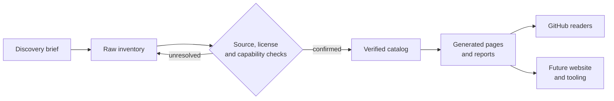

# OpenCode Skills Hub

<p><strong>Discover. Build. Create. Automate.</strong></p>

[](LICENSE)
[](https://www.python.org/)
[](https://opencode.ai)
[](docs/verification.md)
[](CONTRIBUTING.md)

A structured, searchable and evidence-based catalog of **skills, agents, plugins, MCP servers, commands, rules, hooks, providers and workflow collections** for [OpenCode](https://opencode.ai).

Every catalogued resource has a stable ID, a category, a source, a license status, a security label and a verification record. Entries that could not be verified stay in a separate raw inventory instead of being presented as working software.

| Browse | Curate | Verify | Contribute |
| :---: | :---: | :---: | :---: |
| [Categories](categories/README.md) | [Role collections](collections/README.md) | [Methodology](docs/verification.md) | [Contribution guide](CONTRIBUTING.md) |
| [Find by task](#find-by-task) | [Skill packs](collections/README.md) | [Security](SECURITY.md) | [Resource template](docs/resource-template.md) |

> [!IMPORTANT]
> This is a **verification-first catalog**, not a link dump and not an endorsement. A listed resource is not guaranteed to be safe, compatible or maintained. Upstream claims are kept separate from independently observed facts.

---

<details open>
<summary><strong>Table of contents</strong></summary>

- [Why this hub exists](#why-this-hub-exists)
- [30-second tour](#30-second-tour)
- [Catalog at a glance](#catalog-at-a-glance)
- [Categories](#categories)
- [Find by task](#find-by-task)
- [Resource types](#resource-types)
- [How the catalog works](#how-the-catalog-works)
- [Verification and trust](#verification-and-trust)
- [Security model](#security-model)
- [Installation guidance](#installation-guidance)
- [Contributing](#contributing)
- [Repository map](#repository-map)
- [Local development](#local-development)
- [Roadmap](#roadmap)
- [FAQ](#faq)
- [Acknowledgements](#acknowledgements)
- [License](#license)

</details>

---

## Why this hub exists

The OpenCode ecosystem is growing faster than any person can track. Useful skills are scattered across GitHub, npm, PyPI, forums and chat threads. Search results mix real projects with abandoned experiments, copied prompts and unverified links.

| The usual problem | What this hub does |
| --- | --- |
| Links without context | Every entry explains what it does and who it is for |
| Unknown trust level | Source, license, maintenance and security labels are recorded |
| Claimed testing | Installation and functional testing are marked honestly |
| Duplicate entries | Stable IDs and a validator catch duplicates and broken references |
| Unstructured lists | JSON catalog, schemas, generated pages and reports |
| Lost discoveries | Unresolved entries are preserved in a raw inventory |
| Unsafe tooling | Permission-bypass and guardrail-removal tools are excluded |

## 30-second tour

```bash
git clone https://github.com/kanjariyaraj/opencode-skills-hub.git
cd opencode-skills-hub

ls categories/        # browse by domain
ls collections/       # browse by role or skill pack
python3 scripts/validate_catalog.py
```

No build step. No third-party Python packages. Plain Markdown and JSON.

## Catalog at a glance

| Resources | Collections | Categories | Tests |
| ---: | ---: | ---: | ---: |
| **32** | **46** | **18** | **35** |

Counts are produced from [`catalog/*.json`](catalog/). They describe catalog entries, not downloads, stars or upstream quality. The live breakdown is in [`reports/stats.md`](reports/stats.md).

| Signal | Current state |
| --- | --- |
| Sources verified | 32 of 32 catalogued resources |
| Licenses verified | 24 resources |
| License review required | 8 resources |
| High-risk security label | 4 resources |
| Installation tested | 0 resources |
| Raw inventory preserved | 111 entries (57 verified, 46 unresolved, 4 not found, 4 restricted) |

> [!NOTE]
> `0` installation tests is deliberate. Third-party resources were **not** installed on the maintainer's host during cataloging. An upstream README describing an install method is not an independent test result.

## Categories

| Category | Resources | Collections |
| --- | ---: | ---: |
| [Software Development](categories/software-development.md) | 8 | 19 |
| [Mobile Development](categories/mobile-development.md) | 1 | 6 |
| [Android System & Custom ROM](categories/android-system-custom-rom.md) | 2 | 4 |
| [Linux & Low-Level Systems](categories/linux-low-level.md) | 1 | 3 |
| [Database & Backend Infrastructure](categories/database-backend.md) | 2 | 4 |
| [DevOps & Cloud](categories/devops-cloud.md) | 0 | 2 |
| [Cybersecurity](categories/cybersecurity.md) | 4 | 3 |
| [AI & Machine Learning](categories/ai-machine-learning.md) | 0 | 4 |
| [Data Science & Analytics](categories/data-science.md) | 0 | 4 |
| [Game Development](categories/game-development.md) | 0 | 4 |
| [Design & UI/UX](categories/design-ui-ux.md) | 5 | 6 |
| [Image Generation & Editing](categories/image-generation.md) | 5 | 8 |
| [Video Generation & Editing](categories/video-generation.md) | 2 | 5 |
| [Audio, Voice & Music](categories/audio-music.md) | 0 | 3 |
| [Content & Marketing](categories/content-marketing.md) | 0 | 6 |
| [Documents & Productivity](categories/documents-productivity.md) | 2 | 8 |
| [Education & Research](categories/education-research.md) | 0 | 3 |
| [Business & Finance](categories/business-finance.md) | 0 | 4 |

A category can serve users through bundled skill packs even when it has no standalone resource entries yet. **Zero means "no standalone verified entry", not "nothing useful".**

## Find by task

| I want to... | Start here |
| --- | --- |
| Build a web app | [Software Development](categories/software-development.md) · [Full-Stack Developer](collections/role-fullstack-developer.md) |
| Build a Flutter app | [Flutter Developer](collections/role-flutter-developer.md) |
| Build an Android app | [Android Developer](collections/role-android-developer.md) |
| Build a custom Android ROM | [Custom ROM Developer](collections/role-custom-rom-developer.md) |
| Write an Android kernel module | [Kernel Engineer](collections/role-kernel-engineer.md) |
| Work with a database | [Database & Backend](categories/database-backend.md) |
| Set up Docker, Kubernetes or CI | [DevOps & Cloud](categories/devops-cloud.md) |
| Audit my application security | [Cybersecurity](categories/cybersecurity.md) |
| Build an AI/ML or RAG workflow | [AI & Machine Learning](categories/ai-machine-learning.md) |
| Analyze data | [Data Science & Analytics](categories/data-science.md) |
| Make a game | [Game Development](categories/game-development.md) |
| Design a UI or design system | [Design & UI/UX](categories/design-ui-ux.md) |
| Generate or edit images | [Image Generation & Editing](categories/image-generation.md) |
| Generate or edit video | [Video Generation & Editing](categories/video-generation.md) |
| Create audio, voice or music | [Audio, Voice & Music](categories/audio-music.md) |
| Write content or run marketing | [Content & Marketing](categories/content-marketing.md) |
| Process documents and notes | [Documents & Productivity](categories/documents-productivity.md) |
| Read papers or study | [Education & Research](categories/education-research.md) |
| Run a business workflow | [Business & Finance](categories/business-finance.md) |

> [!WARNING]
> Never use an offensive-security resource against a system without explicit written authorization. See [SECURITY.md](SECURITY.md).

## Resource types

<details>
<summary><strong>All eight catalogued types</strong></summary>

| Type | Meaning |
| --- | --- |
| **Skill** | Instructions and scripts an agent loads for a specific task. |
| **Agent** | A specialist persona or workflow role. |
| **Plugin** | Code that extends OpenCode itself. |
| **MCP server** | A Model Context Protocol server exposing tools or data. |
| **Command** | A named workflow triggered from the agent. |
| **Rule** | Persistent behavioural guidance. |
| **Hook** | An event-driven automation. |
| **Provider** | A model or inference provider. |

Collections describe either a **user role** (a curated mapping) or an **upstream skill pack/toolkit** (a bundle catalogued as one entry).

</details>

## How the catalog works



1. **Discover.** Every candidate is recorded in `data/raw-inventory.json`, even when it cannot be verified.
2. **Verify.** A source is checked against GitHub, npm or PyPI metadata. License and capability are recorded.
3. **Publish.** Only confirmed entries move to `catalog/*.json`.
4. **Generate.** Category pages, collection pages and reports are built from the data.
5. **Re-verify.** Entries carry a verification date and maintenance signal so staleness is visible.

## Verification and trust

<details>
<summary><strong>Verification statuses and what they mean</strong></summary>

| Status | Evidence required |
| --- | --- |
| `SOURCE_VERIFIED` | The GitHub, npm or PyPI source was confirmed by metadata. |
| `LICENSE_VERIFIED` | A license was confirmed from registry metadata. |
| `LICENSE_REVIEW_REQUIRED` | No recognized license was found. Do not redistribute until resolved. |
| `COMPATIBILITY_VERIFIED` | OpenCode compatibility was independently checked. |
| `INSTALLATION_TESTED` | Installed in an isolated environment with recorded evidence. |
| `FUNCTIONAL_TESTED` | Executed and behaved as described. |
| `MAINTAINED` | Recent upstream activity was observed. |
| `UNMAINTAINED` | Older upstream activity was observed. Not proof of breakage. |
| `SECURITY_REVIEW_REQUIRED` | Capability warrants review before use. |

</details>

The short version:

- **Source verified** does not mean **installed**.
- **Installed** does not mean **functionally tested**.
- **Maintained** does not mean **safe**.
- **Popular** does not mean **trustworthy**.

Read the full [verification methodology](docs/verification.md).

## Security model

1. **Least privilege.** Review what a resource can read, write, execute or send.
2. **Isolation.** Test in a container, VM or disposable project.
3. **Authorization.** Offensive tooling is only for owned systems or explicit written authorization.

- Security labels are project review labels, not guarantees.
- Offensive-security resources are labelled `HIGH RISK`.
- Permission-bypass and guardrail-removal tooling is excluded from the catalog and documented only in the [restricted archive](restricted/README.md).
- No secrets are stored in the repository.

Read [SECURITY.md](SECURITY.md) and the generated [security review report](reports/security-review.md).

## Installation guidance

This hub does **not** auto-install third-party resources. The safe workflow is:

1. Open the upstream source.
2. Read the README and inspect the files.
3. Check the license and security notes in the catalog.
4. Prefer an isolated environment.
5. Install using the upstream-documented method.
6. Verify the result yourself.
7. Reverse the documented steps to uninstall.

Some entries include an npm or pip command because the package was confirmed in a registry. Those commands are marked `NOT_TESTED`. Copying arbitrary files into `~/.config/opencode/` without review is discouraged.

See [`docs/installation.md`](docs/installation.md).

## Contributing

The most useful contribution is a **verified** resource with a confirmed source, license and honest verification status.

```bash
# 1. Add or edit the entry using the template
open docs/resource-template.md

# 2. Validate and regenerate
make check

# 3. Open a pull request
```

| Quality bar | Requirement |
| --- | --- |
| Source | Reachable GitHub, npm, PyPI or official docs URL |
| Description | Factual, 20–600 characters |
| License | SPDX identifier or an honest review-required status |
| Security | Conservative label |
| Verification | Only statuses you can defend |
| Generated files | Regenerated and committed |

Do not submit invented repositories, guessed package names or unverified install commands. Read [CONTRIBUTING.md](CONTRIBUTING.md) first.

## Repository map

<details>
<summary><strong>Show the full folder structure</strong></summary>

```text
.
├── README.md                 # this file
├── LICENSE                   # MIT
├── CONTRIBUTING.md
├── CODE_OF_CONDUCT.md
├── SECURITY.md
├── SUPPORT.md
├── CHANGELOG.md
├── ROADMAP.md
├── AUTHORS.md
├── CITATION.cff
├── Makefile                  # common local commands
├── catalog/                  # source-of-truth JSON catalog
│   ├── skills.json
│   ├── agents.json
│   ├── plugins.json
│   ├── mcp.json
│   ├── commands.json
│   ├── rules.json
│   ├── hooks.json
│   ├── providers.json
│   ├── collections.json
│   └── index.json            # generated unified index
├── schemas/                  # JSON Schema definitions
├── data/
│   ├── taxonomy.json
│   └── raw-inventory.json
├── categories/               # generated category pages
├── collections/              # generated role and pack pages
├── docs/                     # methodology and guides
├── scripts/                  # validation and generation tools
├── tests/                    # unittest suite
├── reports/                  # generated evidence reports
├── restricted/               # excluded tools and policy
├── website/                  # future website plan
└── .github/                  # CI, issue and PR templates
```

</details>

## Local development

Requirements: Python 3.10+ and Git. No third-party packages are required.

| Command | What it does |
| --- | --- |
| `make validate` | Validate schemas, IDs, categories and references |
| `make generate` | Regenerate indexes, category pages, collections and reports |
| `make test` | Run the unit test suite |
| `make lint` | Lint Markdown |
| `make links` | Check local Markdown links |
| `make check` | Validate, check drift, test and link-check |
| `make network-links` | Probe external catalog URLs (slow, informational) |

Equivalent raw commands:

```bash
python3 scripts/validate_catalog.py
python3 scripts/generate_indexes.py --check
python3 scripts/generate_reports.py --check
python3 scripts/check_links.py
python3 -m unittest discover -s tests -v
```

CI runs validation, generation drift checks, tests, Markdown linting and link checking. See [`.github/workflows/`](.github/workflows/).

## Roadmap

| Phase | Focus | Status |
| --- | --- | --- |
| 1 | Foundation: schemas, catalog, pages, reports, tests, CI | Complete |
| 2 | Coverage: DevOps, AI/ML, data science, game, audio, business | In progress |
| 3 | Isolated installation testing for low-risk resources | Planned |
| 4 | Tag, platform and task indexes | Planned |
| 5 | Static website with search and filters | Planned |
| 6 | Scheduled source re-verification | Planned |

See [ROADMAP.md](ROADMAP.md) for details and non-goals.

## FAQ

<details>
<summary><strong>Is every resource installed and tested?</strong></summary>

No. Source and license verification is recorded separately from installation and functional testing. Most entries are `NOT_TESTED`.

</details>

<details>
<summary><strong>Why are some categories empty?</strong></summary>

They have no standalone verified entry yet, but may still list upstream skill packs. Empty means "not verified individually", not "nothing useful".

</details>

<details>
<summary><strong>Can I add my project?</strong></summary>

Yes, if it is real, reachable and honestly described. Use the [resource template](docs/resource-template.md) and read [CONTRIBUTING.md](CONTRIBUTING.md).

</details>

<details>
<summary><strong>Why not include permission-bypass tools?</strong></summary>

They remove the user's ability to consent to actions. They are documented only in the [restricted archive](restricted/README.md) and are not recommended.

</details>

More questions: [`docs/faq.md`](docs/faq.md).

## Acknowledgements

This catalog builds on the work of the OpenCode community and the upstream maintainers of every listed project. Resources remain the property of their authors and are governed by their own licenses. See [AUTHORS.md](AUTHORS.md) and the per-resource source links.

Inclusion is not an endorsement, sponsorship or transfer of authorship.

## License

This repository's own content is licensed under the [MIT License](LICENSE). Upstream resources are **not** covered by this license; consult each upstream project.

---

<p align="center"><strong>OpenCode Skills Hub</strong><br/>Discover. Build. Create. Automate.</p>
